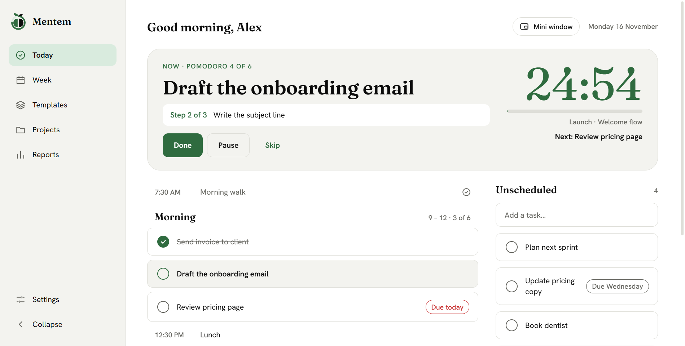
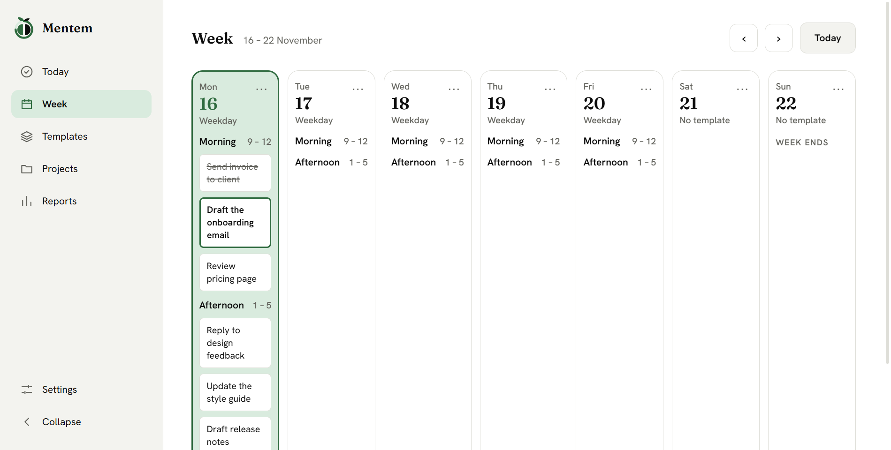
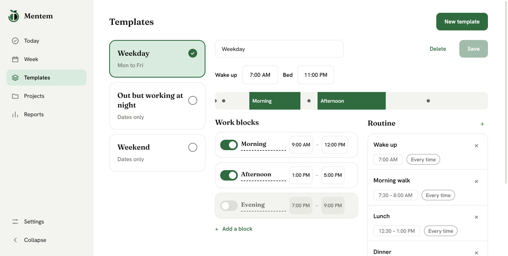
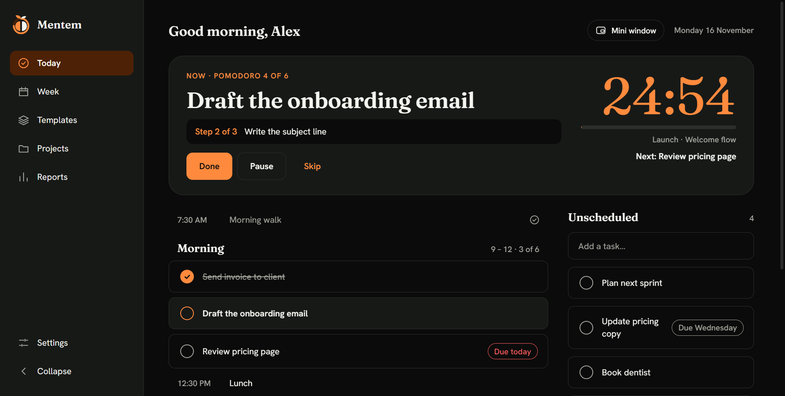

<p align="center">
  
</p>

<h1 align="center">Mentem</h1>

<p align="center">
  A planner and focus timer for brains that lose the thread.<br>
  It always knows what you are doing right now, and what comes next.
</p>

<p align="center">
  
</p>

## Why

Most planners hand you a list and wish you luck. Mentem does the deciding for you. Describe your day once, put tasks in the blocks you want to work in, and the timer carries you through: pomodoro after pomodoro, break after break, task after task, with the current task and step in front of you the whole time.

When the day goes sideways, nothing breaks. Unfinished work rolls over, anything without a home waits in **Unscheduled**, and the week gets a short review so you can see what actually happened.

## What you get

**A timer that never stops asking "what now?"**
Continuous pomodoros run through each work block. Short and long breaks, pause, skip and done, with the task, its steps and the next task always on screen. A mini window and a tray icon keep it visible when the app is closed.

**A day that matches your real one**
Templates hold your wake and bed times, routine items (lunch, a walk, dinner) and as many work blocks as fit in the day. Use one for weekdays, another for weekends, and change a single day without touching the template.

**Meetings that the timer respects**
A Meetings page lists what is coming and what has passed. Each meeting is online (with a link) or in person (with a place), has an agenda and people, can repeat, and has room for minutes, written separately for every day it happens. While one runs the pomodoro steps aside, then picks up with the time that was left. The block still ends when it was meant to.

**Tasks with room to breathe**
Steps, due dates, pomodoro estimates, projects and deliverables. Drag a task into a block or leave it in Unscheduled. Repeats can be daily, every third day, certain weekdays, monthly or yearly.

**Weeks you can look back on**
Planning at the start of a week, a report at the end: planned versus done, done on time, rollovers and postponements. Finished tasks stay struck through, with the date they were finished.

**A command line for everything**
Add tasks, place them, pause the timer or read the week without leaving the terminal.

**Yours alone**
Everything lives in a local SQLite file. Automatic snapshots, manual backups, and JSON export and import. No account and no network.

<table>
  <tr>
    <td width="50%"><br><sub>The week, one column per day</sub></td>
    <td width="50%"><br><sub>Templates: blocks and routine in one place</sub></td>
  </tr>
</table>

<p align="center">
  <br>
  <sub>Four themes: white and green, white and black, black and orange, black and white</sub>
</p>

## Command line

The app installs a `mentem` launcher the first time it runs.

```bash
mentem today                                        # the day, block by block
mentem task add "Write the report" --due fri --est 3
mentem assign <id> --date today --block Morning
mentem assign <id> --date today --block Morning --repeat daily --every 3
mentem now                                          # what is running, and what is left
mentem extend 30                                    # run the current block 30 minutes longer today
mentem pause                                        # control the running app
mentem week
mentem report
```

Run `mentem help` for the full list.

## Install

Download the installer from the [latest release](https://github.com/alexindevs/mentem/releases/latest): `Mentem-Setup-<version>.exe` for Windows, `mentem_<version>_amd64.deb` for Debian and Ubuntu (`sudo apt install ./mentem_<version>_amd64.deb`), or `mentem_<version>_x64.pacman` for Arch (`sudo pacman -U ./mentem_<version>_x64.pacman`).

The app looks for new versions by itself, downloads them quietly and installs them when you quit. Your data lives in its own folder (`%APPDATA%\mentem` on Windows), so updating or uninstalling never touches it, and a backup is taken before each update.

## Run it

Needs Node 22 and pnpm.

```bash
pnpm install
pnpm --filter @mentem/desktop start
```

```bash
pnpm test         # every package
pnpm typecheck
pnpm lint
```

## How it is built

| Package | What it is |
| --- | --- |
| `packages/core` | The data layer and timer engine: SQLite store, forward-only migrations, repeats, rollover, reports. No UI, fully tested. |
| `packages/desktop` | The Electron app. React 19, Motion, Tailwind over CSS variables for the themes. One validated IPC channel between the window and the main process. |
| `packages/cli` | The `mentem` command, talking to the same database and to the running app over a local socket. |

The timer is event-driven: one timer is armed for the next change, so an idle app uses almost nothing.

## Releasing

Bump `version` in `packages/desktop/package.json`, commit, then push a matching tag:

```bash
git tag v0.1.1
git push origin v0.1.1
```

GitHub Actions builds the Windows installer and the `.deb`, attaches them to a release and publishes the update feed. Every push to `main` also builds both and keeps them as downloadable artifacts. To build locally, run `pnpm --filter @mentem/desktop package:win` (the result is in `packages/desktop/release`).
